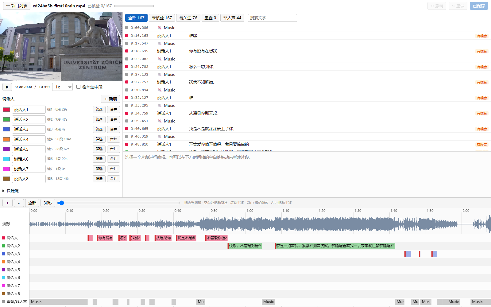

# 前十分钟识别归档

保存日期：2026-11-19。原素材 `cd24ba5bcfee4ca6b555bffef5b65e8c.mp4`，
截取从 00:00 开始的前 600 秒，流复制后的实际时长为 600.040 秒。
本次在独立 Python 3.11 环境中完成流水线 step1 至 step7，使用 CUDA。

| 文件 | 内容 |
| --- | --- |
| project.json | 完整逐段结果、词级时间、说话人标签、标记及核验状态；路径已相对化 |
| transcription.txt | 带时间与说话人标签的可读文本 |
| subtitles.srt | 非空 speech 段字幕 |
| stats.json | 自动统计与运行信息 |
| peaks.json | 核验界面使用的音频波形 |
| review-desktop.png | 桌面核验界面截图，视频暂停于 03:00 |

识别结果：167 段，其中 speech 123 段、non_speech 44 段；121 条非空字幕，
8 个说话人聚类。167 段仍未人工核验。片头约 165 秒包含音乐与歌声，部分歌词被
当作对话；聚类数不代表已确认的人物数。未检出 overlap 不等于不存在重叠说话。
未提供人工标注，没有测量 DER/CER。



界面源码保存在仓库 `frontend/src/`。本机入口：
`http://127.0.0.1:8000/?p=cd24ba5b_first10min`。
关闭程序后在项目根目录运行 `Start-Review.ps1`。
截图不保存浏览器中的临时筛选、选中片段或未提交编辑；project.json 保存的是后端已落盘状态。

视频、音轨、模型和凭据不包含在归档中。换机器时需要另备同一起点、同一时间轴的
十分钟视频。详见 [Windows 环境与恢复](../../docs/windows-runtime.md)。

```powershell
.\.venv\Scripts\python.exe -m backend.restore_run runs\cd24ba5b_first10min --media "E:\Voice_purify\data\input\cd24ba5b_first10min.mp4"
```

恢复命令不会覆盖已有核验项目；音频导出还需要另外保留原始分析与导出 WAV。
